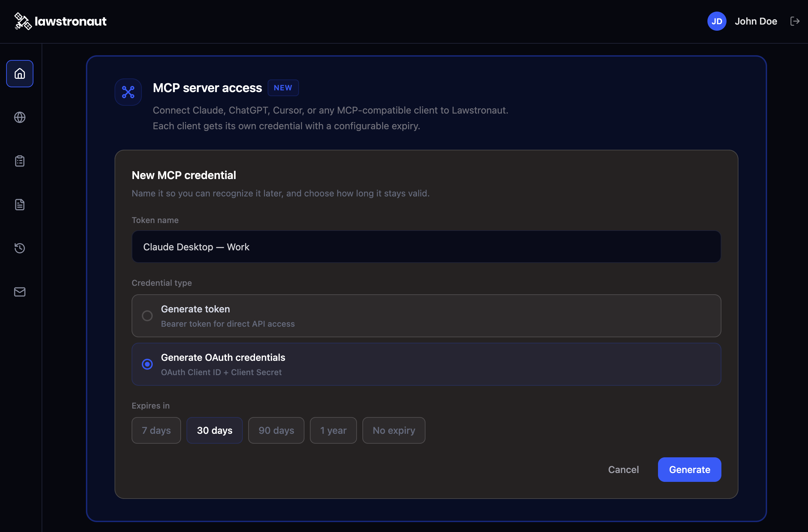
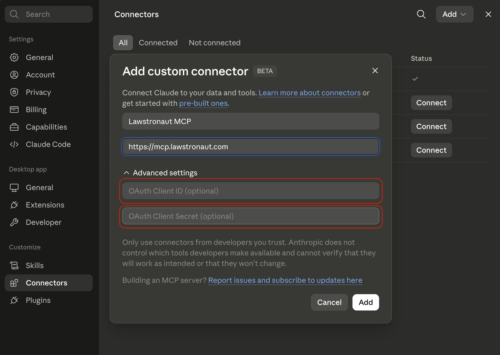

<div align="center">


# Lawstronaut MCP 2.0

Connect [lawstronaut](https://mcp.lawstronaut.com) to Claude, ChatGPT, Cursor, and any AI agent that speaks the [Model Context Protocol](https://modelcontextprotocol.io). Connect your AI to 115+ million laws and court cases!

[](https://modelcontextprotocol.io)
[](#authentication--scopes)
[](https://lawstronaut.com/products/lawstronaut-mcp)
[](./LICENSE)

 [Authentication](#Authentication) . [Setup](#setup) · [Tools](#tools)

</div>

---

## What is this?

Lawstronaut is the infrastructure layer that connects AI agents and software to millions of legal documents across 150+ jurisdictions, structured legal data, continuously updated, and ready to use via MCP.

## Authentication

Production MCP server: **`https://mcp.lawstronaut.com`**

Transport: **MCP over Streamable HTTP** (`POST /`).

Public server card (tool listing, no auth):  
`https://mcp.lawstronaut.com/.well-known/mcp/server-card.json`

---


Lawstronaut MCP supports **Bearer token** and **OAuth 2.0** (`client_id` + `client_secret`). A paid subscription is required.

| Method | Best for | Tool listing | Tool calls |
|--------|----------|--------------|------------|
| Bearer token | CLI, scripts, clients without OAuth | No auth required | `Authorization: Bearer <token>` |
| OAuth 2.0 | Cursor, VS Code, Claude, publishing platforms | No auth required | OAuth access token (auto-managed by client) |

### Get client ID, secret, or bearer token

1. Visit [lawstronaut.com](https://lawstronaut.com) and purchase a subscription.
2. Log in to the [developer portal](https://dev-portal.filerskeepersapi.co/).
3. Open **MCP server access** from the Home menu.
4. Create a **client ID** + **client secret** (OAuth) or a **bearer token**.



### Option A — Bearer token

Use the bearer token from **MCP server access**:

```http
Authorization: Bearer <your-token>
```

Set it in your environment:

```bash
export LAWSTRONAUT_MCP_BEARER_TOKEN="your-token-here"
```

Example configs: `cursor-mcp.json`, `vscode-mcp.json`, `claude-code.mcp.json`.

### Option B — OAuth 2.0 (client_id + client_secret)

Use the `client_id` and `client_secret` created under **MCP server access** in the [developer portal](https://dev-portal.filerskeepersapi.co/).

| Endpoint | URL |
|----------|-----|
| MCP server | `https://mcp.lawstronaut.com` |
| Authorization | `https://mcp.lawstronaut.com/oauth/authorize` |
| Token | `https://mcp.lawstronaut.com/oauth/token` |
| OAuth discovery | `https://mcp.lawstronaut.com/.well-known/oauth-authorization-server` |
| Protected resource | `https://mcp.lawstronaut.com/.well-known/oauth-protected-resource` |

**Flow:** `response_type=code` → redirect with `code` → exchange at `/oauth/token` with `grant_type=authorization_code`, `client_id`, `client_secret`, `code`, and `redirect_uri`.

Clients that support MCP OAuth discovery only need the server URL — they handle the flow using your registered `client_id` / `client_secret`.

Example configs: `cursor-mcp-oauth.json`, `vscode-mcp-oauth.json`.

---
## Setup
Pick your client, paste the config, and authenticate with your lawstronaut account. Most clients open a browser window for OAuth the first time an agent uses a lawstronaut tools.

## Cursor

**Bearer token**

1. Copy `cursor-mcp.json` to `.cursor/mcp.json` (project) or `~/.cursor/mcp.json` (global).
2. Export `LAWSTRONAUT_MCP_BEARER_TOKEN`.
3. Restart Cursor. Check **Output → MCP Logs** if connection fails.

**OAuth**

1. Copy `cursor-mcp-oauth.json` to `.cursor/mcp.json`.
2. Complete the OAuth sign-in when Cursor prompts you (uses your registered `client_id` / `client_secret`).

Docs: [Cursor MCP](https://cursor.com/docs/context/mcp).

---

## VS Code (GitHub Copilot agent / MCP)

**Bearer token**

1. Copy `vscode-mcp.json` to `.vscode/mcp.json`, or merge into your [user MCP config](https://code.visualstudio.com/docs/copilot/reference/mcp-configuration).
2. Run **MCP: List Servers** and enter your bearer token when prompted.

**OAuth**

1. Copy `vscode-mcp-oauth.json` to `.vscode/mcp.json`.
2. Sign in through VS Code when prompted.

Docs: [MCP configuration reference](https://code.visualstudio.com/docs/copilot/reference/mcp-configuration).

---

## Claude Code (CLI)

**Bearer token — CLI**

```bash
export LAWSTRONAUT_MCP_BEARER_TOKEN="your-token-here"

claude mcp add --transport http lawstronaut-mcp https://mcp.lawstronaut.com \
  --header "Authorization: Bearer $LAWSTRONAUT_MCP_BEARER_TOKEN"
```

**Bearer token — project file**

Copy `claude-code.mcp.json` to `.mcp.json` in your project root.

**OAuth**

Add the server URL only and complete OAuth when prompted:

```bash
claude mcp add --transport http lawstronaut-mcp https://mcp.lawstronaut.com
```

Docs: [Connect Claude Code to tools via MCP](https://code.claude.com/docs/en/mcp).

---

## Claude Desktop (Anthropic app)

Claude Desktop is oriented toward **stdio** MCP servers. For this HTTP server, use **Cursor**, **VS Code**, or **Claude Code**, or any host that supports remote Streamable HTTP MCP.

Go to **Customize**, **Connectors**, click "**+**", **Add Custom Connector**, and fill the dialog:



---

## Other hosts (Continue, Zed, custom agents, etc.)

Any client that supports **MCP Streamable HTTP** can connect with:

- **URL:** `https://mcp.lawstronaut.com`
- **Bearer:** `Authorization: Bearer <token>`
- **OAuth:** use discovery at `/.well-known/oauth-authorization-server` with your `client_id` / `client_secret`

---

## Tools

- **list_jurisdictions** — List every country and state in the authenticated subscription (name, iso, type, documents_count). Call first to get valid ISO codes. Takes no parameters.

- **list_domains** — List top-level legal domains (id, domain_id, domain). Pass `domain_id` to `list_subdomains`.
  - `domain`: Filter by domain name (string, optional)
  - `limit`: Number of results to return (number, optional)
  - `next_id`: Next ID to paginate the results (number, optional)

- **list_subdomains** — List subdomains under one domain. Pass `subdomain_id` to `list_categories`.
  - `domain_id`: Filter by Domain ID (string, required)
  - `subdomain`: Filter by subdomain name (string, optional)
  - `limit`: Number of results to return (number, optional)
  - `next_id`: Next ID to paginate the results (number, optional)

- **list_categories** — List categories under one subdomain. Pass `category_id` to `list_subcategories`.
  - `subdomain_id`: Filter by Subdomain ID (string, optional)
  - `category_name`: Filter by category name (string, optional)
  - `limit`: Number of results to return (number, optional)
  - `next_id`: Next ID to paginate the results (number, optional)

- **list_subcategories** — List subcategories under one category. Pass `subcategory_id` to `list_law_types`.
  - `category_id`: Filter by Category ID (string, required)
  - `subcategory_name`: Filter by subcategory name (string, optional)
  - `limit`: Number of results to return (number, optional)
  - `next_id`: Next ID to paginate the results (number, optional)

- **list_law_types** — List law types under one subcategory. Last taxonomy step; does not return documents.
  - `subcategory_id`: Filter by Subcategory ID (string, required)
  - `law_type`: Filter by law type name (string, optional)
  - `limit`: Number of results to return (number, optional)
  - `next_id`: Next ID to paginate the results (number, optional)

- **list_portals** — List source portals for a jurisdiction. Filter by name, tag, language, or portal ID.
  - `iso`: Jurisdiction code from `list_jurisdictions` (e.g. `BE`, or `US_CA` for a state) (string, required)
  - `name`: Case-insensitive substring of the portal name (string, optional)
  - `portal_tags`: Exact portal tag; the portal must include this tag (string, optional)
  - `lang`: Exact language name, e.g. English (string, optional)
  - `portal_id`: Portal ID (number, optional)
  - `limit`: Number of portals to return (number, optional)
  - `next_id`: Next portal ID to return (number, optional)
  - `advanced_search`: Advanced search enabled (boolean, required, default `false`)

- **list_authority_types** — List authority types for a jurisdiction. Filter by portal name or authority type.
  - `iso`: Filter by Jurisdiction ISO code (e.g. 'US') (string, required)
  - `limit`: Number of results to return (number, optional)
  - `next_id`: Next portal ID to return (number, optional)
  - `portal_name`: Filter by portal name (string, optional)
  - `authority_type`: Filter by authority type (string, optional)

- **list_issuing_authorities** — List issuing authorities for a jurisdiction. Filter by portal name or authority name.
  - `iso`: Filter by Jurisdiction ISO code (e.g. 'US') (string, required)
  - `limit`: Number of results to return (number, optional)
  - `next_id`: Next issuing authority ID to return (number, optional)
  - `portal_name`: Filter by portal name (string, optional)
  - `issuing_authority`: Filter by issuing authority (string, optional)

- **list_documents** — List document metadata in a jurisdiction (title, dates, source, classification). Does not return the body, a citation bundle, or a source-file URL.
  - `iso`: Filter by Jurisdiction ISO code (e.g. 'US') (string, required)
  - `limit`: Page size. Default 20, maximum 100 (integer, optional)
  - `portal`: Filter by portal name (string, optional)
  - `portal_id`: Filter by portal ID (number, optional)
  - `lang`: Exact portal language name, for example English. Filters the portal, not the document language (string, optional)
  - `status`: Filter by document status (string, optional)
  - `url`: Filter by document URL (string, optional)
  - `is_repealed`: Filter by repealed documents (boolean, required, default `false`)
  - `crawling_date`: `YYYY-MM-DD`, or a range `YYYY-MM-DD-to-YYYY-MM-DD` (string, optional)
  - `last_updated`: `YYYY-MM-DD`, or a range `YYYY-MM-DD-to-YYYY-MM-DD` (string, optional)
  - `last_amendment`: `YYYY-MM-DD`, or a range `YYYY-MM-DD-to-YYYY-MM-DD` (string, optional)
  - `publication_date`: `YYYY-MM-DD`, or a range `YYYY-MM-DD-to-YYYY-MM-DD` (string, optional)
  - `expiration_date`: `YYYY-MM-DD`, or a range `YYYY-MM-DD-to-YYYY-MM-DD` (string, optional)
  - `effective_date`: `YYYY-MM-DD`, or a range `YYYY-MM-DD-to-YYYY-MM-DD` (string, optional)
  - `date_of_enactment`: `YYYY-MM-DD`, or a range `YYYY-MM-DD-to-YYYY-MM-DD` (string, optional)
  - `uuid`: Filter by UUID (string, optional)
  - `next_id`: Document id of the first row of the next page, from `pagination.next_id`. Omit on the first page (number, optional)
  - `include_total`: Include total count in the response (boolean, required, default `false`)
  - `title`: Filter by title (string, optional)
  - `version`: Filter by version (string, optional)
  - `section_title`: Filter by section title (string, optional)
  - `date_of_decision`: `YYYY-MM-DD`, or a range `YYYY-MM-DD-to-YYYY-MM-DD` (string, optional)
  - `file_data_only`: `false` returns documents with and without file metadata. `true` returns only documents with file metadata (boolean, required, default `false`)
  - `issuing_authority`: Filter by issuing authority (string, optional)
  - `type_of_authority`: Filter by type of authority (string, optional)
  - `source_identifier`: Filter by source identifier (string, optional)
  - `source_secondary_identifier`: Filter by secondary source identifier (string, optional)
  - `tag`: Filter by portal tag (string, optional)
  - `issuing_authority_tags`: Filter by issuing authority tags (array of strings, optional)

- **list_full_text** — Return the plain-text body of matching documents (`id`, `uuid`, `version`, `text`). No Markdown structure and no citation metadata.
  - `iso`: Filter by Jurisdiction ISO code (e.g. 'US') (string, required)
  - `limit`: Page size. Default 20, maximum 100 (integer, optional)
  - `portal`: Filter by portal name (string, optional)
  - `portal_id`: Filter by portal ID (number, optional)
  - `lang`: Exact portal language name, for example English. Filters the portal, not the document language (string, optional)
  - `status`: Filter by document status (string, optional)
  - `url`: Filter by document URL (string, optional)
  - `is_repealed`: Filter by repealed documents (boolean, required, default `false`)
  - `crawling_date`: `YYYY-MM-DD`, or a range `YYYY-MM-DD-to-YYYY-MM-DD` (string, optional)
  - `last_updated`: `YYYY-MM-DD`, or a range `YYYY-MM-DD-to-YYYY-MM-DD` (string, optional)
  - `last_amendment`: `YYYY-MM-DD`, or a range `YYYY-MM-DD-to-YYYY-MM-DD` (string, optional)
  - `publication_date`: `YYYY-MM-DD`, or a range `YYYY-MM-DD-to-YYYY-MM-DD` (string, optional)
  - `expiration_date`: `YYYY-MM-DD`, or a range `YYYY-MM-DD-to-YYYY-MM-DD` (string, optional)
  - `effective_date`: `YYYY-MM-DD`, or a range `YYYY-MM-DD-to-YYYY-MM-DD` (string, optional)
  - `date_of_enactment`: `YYYY-MM-DD`, or a range `YYYY-MM-DD-to-YYYY-MM-DD` (string, optional)
  - `uuid`: Filter by UUID (string, optional)
  - `next_id`: Document id of the first row of the next page, from `pagination.next_id`. Omit on the first page (number, optional)
  - `include_total`: Include total count in the response (boolean, required, default `false`)
  - `title`: Filter by title (string, optional)
  - `with_empty_data`: Include documents that have no stored plain text (`text` is null). Default omits them (boolean, required, default `false`)

- **list_markdown** — Return the structured Markdown body of matching documents (`id`, `uuid`, `version`, `markdown`). Headings and lists stay intact.
  - `iso`: Filter by Jurisdiction ISO code (e.g. 'US') (string, required)
  - `limit`: Page size. Default 20, maximum 100 (integer, optional)
  - `portal`: Filter by portal name (string, optional)
  - `portal_id`: Filter by portal ID (number, optional)
  - `lang`: Exact portal language name, for example English. Filters the portal, not the document language (string, optional)
  - `status`: Filter by document status (string, optional)
  - `url`: Filter by document URL (string, optional)
  - `is_repealed`: Filter by repealed documents (boolean, required, default `false`)
  - `crawling_date`: `YYYY-MM-DD`, or a range `YYYY-MM-DD-to-YYYY-MM-DD` (string, optional)
  - `last_updated`: `YYYY-MM-DD`, or a range `YYYY-MM-DD-to-YYYY-MM-DD` (string, optional)
  - `last_amendment`: `YYYY-MM-DD`, or a range `YYYY-MM-DD-to-YYYY-MM-DD` (string, optional)
  - `publication_date`: `YYYY-MM-DD`, or a range `YYYY-MM-DD-to-YYYY-MM-DD` (string, optional)
  - `expiration_date`: `YYYY-MM-DD`, or a range `YYYY-MM-DD-to-YYYY-MM-DD` (string, optional)
  - `effective_date`: `YYYY-MM-DD`, or a range `YYYY-MM-DD-to-YYYY-MM-DD` (string, optional)
  - `date_of_enactment`: `YYYY-MM-DD`, or a range `YYYY-MM-DD-to-YYYY-MM-DD` (string, optional)
  - `uuid`: Filter by UUID (string, optional)
  - `next_id`: Document id of the first row of the next page, from `pagination.next_id`. Omit on the first page (number, optional)
  - `include_total`: Include total count in the response (boolean, required, default `false`)
  - `title`: Filter by title (string, optional)
  - `with_empty_data`: Include documents that have no stored Markdown (`markdown` is null). Default omits them (boolean, required, default `false`)

- **document_presigned_url** — Return a temporary signed URL to the original source file (PDF or other stored file) for one document. The URL expires.
  - `uuid`: Document UUID (string, required)

- **document_version** — Retrieve one document at a specific version, including metadata and both text bodies.
  - `uuid`: Document UUID (string, required)
  - `version`: Version (integer, required)

- **horizon_scan** — Scan recent legal documents in one jurisdiction. Filter by topic, date window, status, and authority.
  - `iso`: One ISO code, e.g. `IE`, `NL`, `US` (string, required)
  - `since`: Freshness window. `yesterday`, `today`, `Nd` / `Nh` / `Nw` (e.g. `7d`), or ISO date `YYYY-MM-DD` (string, required, default `yesterday`)
  - `topic`: Optional filter matched against the title, e.g. `employee monitoring` (string, optional)
  - `date_field`: Which date to window on. `crawl_date`, `publication_date`, or `last_updated` (string, required, default `crawling_date`)
  - `status`: Optional filter on status, e.g. `new` or `updated` (string, optional)
  - `issuing_authority`: Optional filter on issuing authority (string, optional)
  - `type_of_authority`: Optional filter on type of authority (string, optional)
  - `include_repealed`: When `false`, drop documents where repealed is true (boolean, required, default `false`)
  - `max_per_jurisdiction`: Max documents to return per jurisdiction, 1–100 (integer, required, default `20`)

- **evidence_pull** — Return one citation bundle: metadata, permanent `legal_link`, citation template, body, and a temporary source-file URL when one exists.
  - `iso`: Document's jurisdiction ISO code, e.g. `IE`, `NL`, `US` (string, required)
  - `uuid`: Document UUID (string, required)
  - `include_text`: Fetch the full body (boolean, required, default `true`)
  - `include_source_url`: Fetch a temporary signed URL to the original file where available (boolean, required, default `true`)
  - `text_format`: `markdown` (preserves structure) or `plain` (string, required, default `markdown`)

- **search** — Search legal documents with OpenSearch. Returns matching documents and their metadata. Use `list_documents` to browse with structured filters and cursor pagination.
  - `iso`: Filter by Jurisdiction ISO code (e.g. 'US') (string, required)
  - `limit`: Page size. Default 20, maximum 100 (integer, optional)
  - `portal`: Filter by portal name (string, optional)
  - `portal_id`: Filter by portal ID (number, optional)
  - `lang`: Exact portal language name, for example English. Filters the portal, not the document language (string, optional)
  - `status`: Filter by document status (string, optional)
  - `url`: Filter by document URL (string, optional)
  - `is_repealed`: Filter by repealed documents (boolean, required, default `false`)
  - `crawling_date`: `YYYY-MM-DD`, or a range `YYYY-MM-DD-to-YYYY-MM-DD` (string, optional)
  - `last_updated`: `YYYY-MM-DD`, or a range `YYYY-MM-DD-to-YYYY-MM-DD` (string, optional)
  - `last_amendment`: `YYYY-MM-DD`, or a range `YYYY-MM-DD-to-YYYY-MM-DD` (string, optional)
  - `publication_date`: `YYYY-MM-DD`, or a range `YYYY-MM-DD-to-YYYY-MM-DD` (string, optional)
  - `expiration_date`: `YYYY-MM-DD`, or a range `YYYY-MM-DD-to-YYYY-MM-DD` (string, optional)
  - `effective_date`: `YYYY-MM-DD`, or a range `YYYY-MM-DD-to-YYYY-MM-DD` (string, optional)
  - `date_of_enactment`: `YYYY-MM-DD`, or a range `YYYY-MM-DD-to-YYYY-MM-DD` (string, optional)
  - `uuid`: Filter by UUID (string, optional)
  - `next_id`: Document id of the first row of the next page, from `pagination.next_id`. Omit on the first page (number, optional)
  - `include_total`: Include total count in the response (boolean, required, default `false`)
  - `file_data_only`: Filter by file data only (boolean, required, default `false`)
  - `version`: Filter by version (string, optional)
  - `date_of_decision`: `YYYY-MM-DD`, or a range `YYYY-MM-DD-to-YYYY-MM-DD` (string, optional)
  - `issuing_authority`: Filter by issuing authority (string, optional)
  - `type_of_authority`: Filter by type of authority (string, optional)
  - `source_identifier`: Filter by source identifier (string, optional)
  - `source_secondary_identifier`: Filter by secondary source identifier (string, optional)
  - `tag`: Filter by tag (string, optional)
  - `issuing_authority_tags`: Filter by issuing authority tags (array of strings, optional)
  - `keyword`: Search text matched against the heading and the body. Omit it to list by filters only, newest document id first (string, optional)

All tools are read-only. OAuth tokens are issued with scope `mcp:tools:read`. Tool listing is public; tool calls require authentication.

---
